# MeetReady

A meeting scheduler in the style of Calendly, with AI built in. A host sets their meeting types and weekly hours
and shares a link. Guests see free times in their own timezone and book one. Guests can also describe a time in
their own words, and the host can book or check meetings from Claude.

**Live:** [meetreadyv2.vercel.app](https://meetreadyv2.vercel.app). Try a booking page:
[meetreadyv2.vercel.app/sakifazwad18/intro](https://meetreadyv2.vercel.app/sakifazwad18/intro)

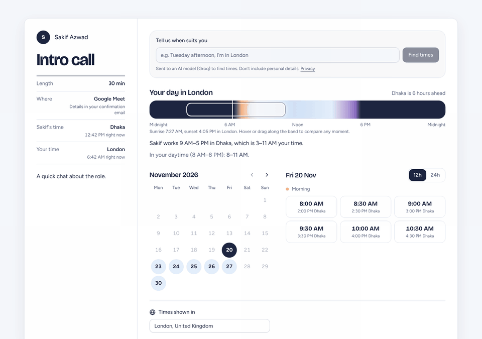

## Highlights

- **Double booking can't happen, even in a race.** The booking re-checks the time, takes a per-host lock, and
  Postgres has an exclusion constraint as the last guard. Tests start two bookings at the same moment against real
  Postgres to prove it. ([Day 4](docs/day-04.md))
- **Timezones are handled correctly, DST included.** Free times come from one pure function that is tested with
  property-based tests. The booking page, emails, the AI assistant and the MCP tools all use that function.
  ([Day 1](docs/day-01.md), [Day 9](docs/day-09.md))
- **An AI booking assistant that can't make up times.** The model turns the guest's sentence into a search. Code
  checks the search and runs it through the slot function. Suggested times come from the tool's results, never from
  the model's text. ([Day 19](docs/day-19.md), [Day 20](docs/day-20.md))
- **An MCP server, so Claude can read, book, move and cancel meetings.** MeetReady is its own OAuth 2.1 server, with
  Client ID Metadata Documents, PKCE, tokens bound to the server and rotating refresh tokens. Where the client
  supports it, every change needs a confirm form that the model can't fill in.
  ([Day 21](docs/day-21.md), [Day 22](docs/day-22.md), [Day 24](docs/day-24.md))
- **A booking widget for any website, inline or as a popup.** A small script with no dependencies frames one page
  that only that route allows to be framed. Messages are checked by origin and by source, and never carry the
  guest's details. The frame resizes itself, and Escape works from inside it. ([Day 27](docs/day-27.md))
- **AI meeting briefs with five layers of protection against prompt injection,** plus a cost log for every call
  and evals against the real model. ([Day 18](docs/day-18.md))
- **Production work around the core.** Google Calendar sync with Meet links, background jobs with retries, rate
  limits, and Sentry with a privacy scrubber. About 810 unit tests and 53 browser tests run in CI.
  ([Days 11–17](#design-notes))

## Screenshots

|                                          Booking page, after the assistant answered                                           |                          On a phone                           |
| :---------------------------------------------------------------------------------------------------------------------------: | :-----------------------------------------------------------: |
| 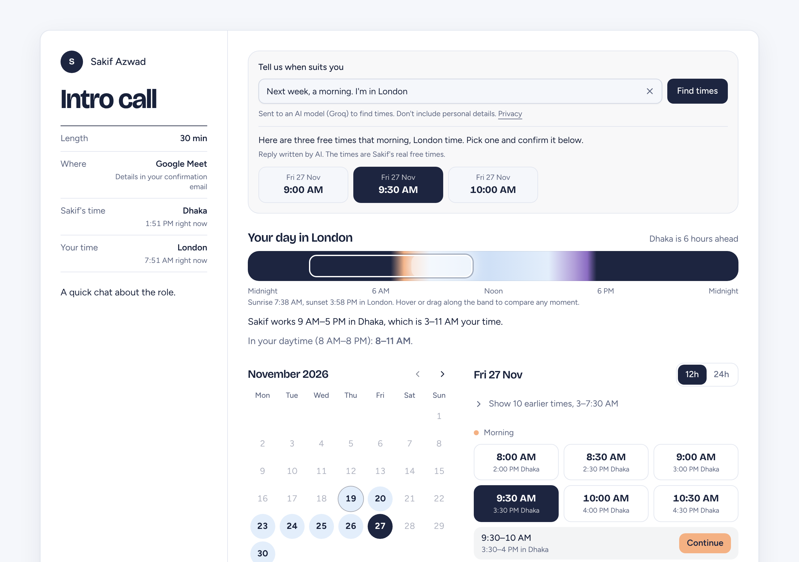 | 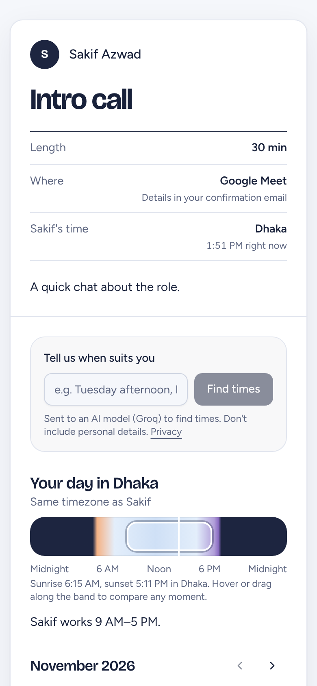 |

**The host's dashboard.** The next seven days on the daylight band: working hours are outlined and meetings are
filled in.

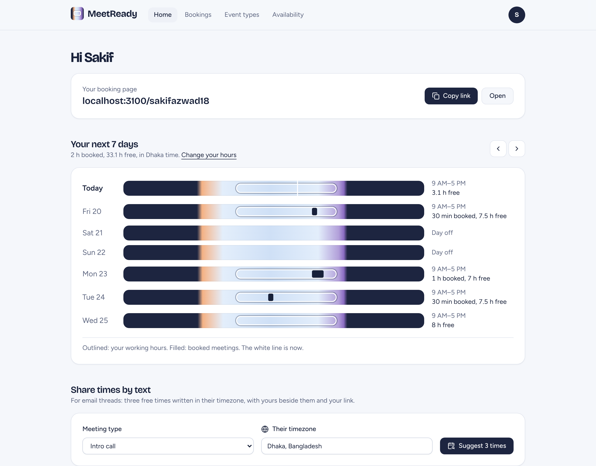

**Bookings, with the AI brief.** The meeting with Grace was booked through Claude, and the badge says so.

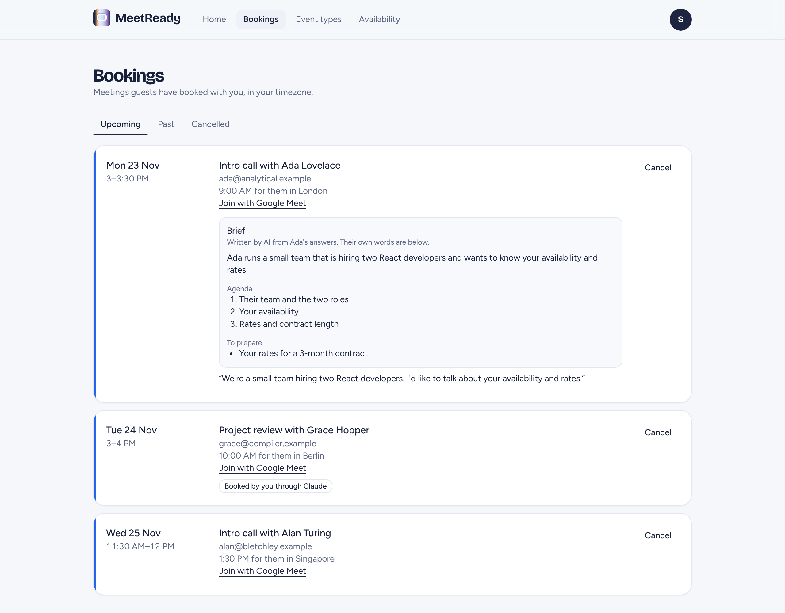

**Insights.** How meetings went over the last weeks or months, grouped in the host's timezone by Postgres: held,
missed and cancelled per week, the rates, popular times under the day's own sky, and meetings per type.

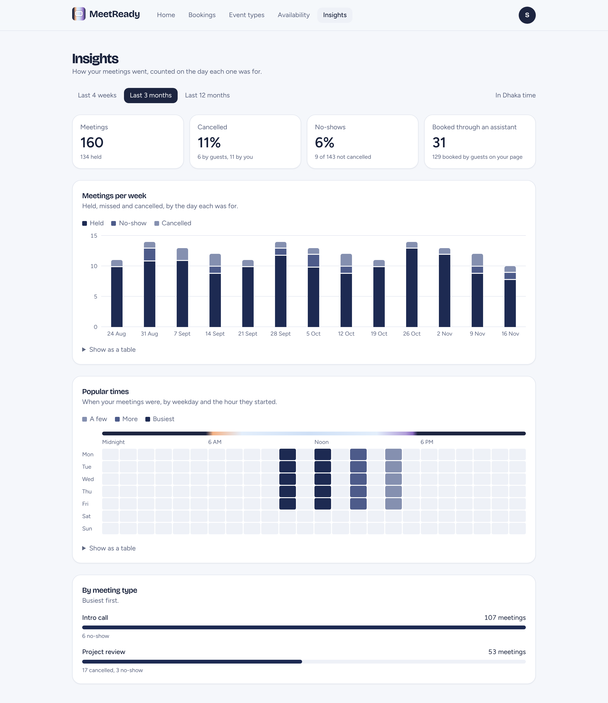

**On someone else's website.** The same booking page as a popup over a host's own site (here a test page on
another origin). Guides for site owners: [docs/embed.md](docs/embed.md).

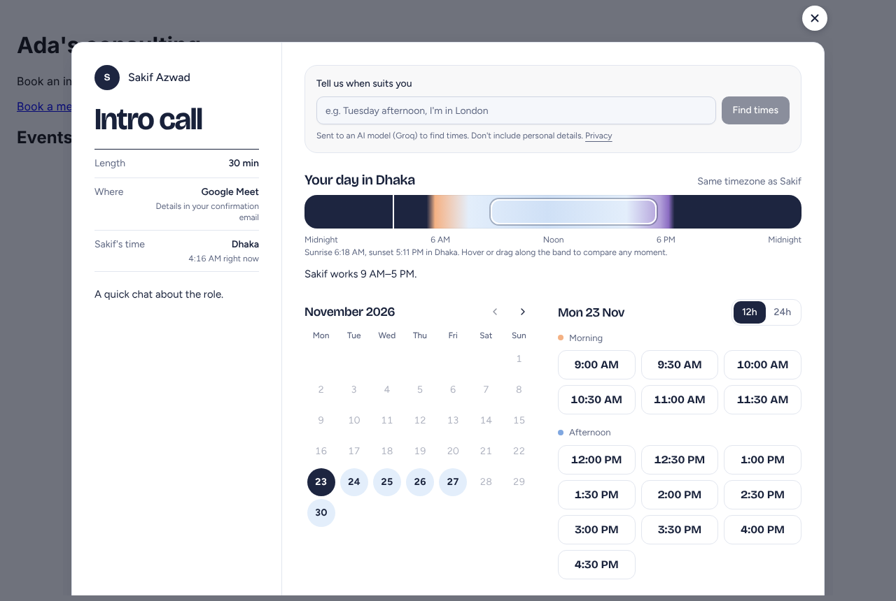

**Connecting Claude.** The host pastes one address into Claude and approves it on MeetReady's own consent page.
They can disconnect from the dashboard at any time.

| 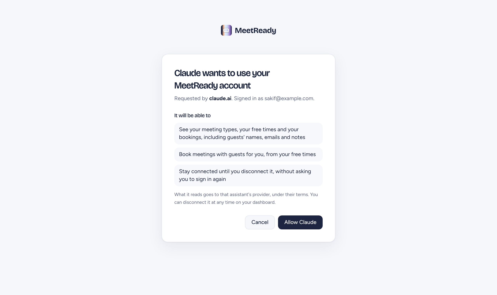 | 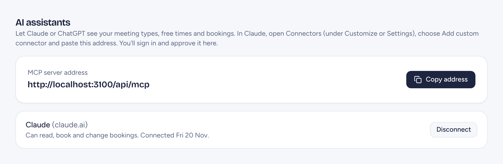 |
| :----------------------------------------------------------------------------------: | :--------------------------------------------------------------------------------------------------------: |

Claude booking through MeetReady (add your own screenshot from claude.ai):
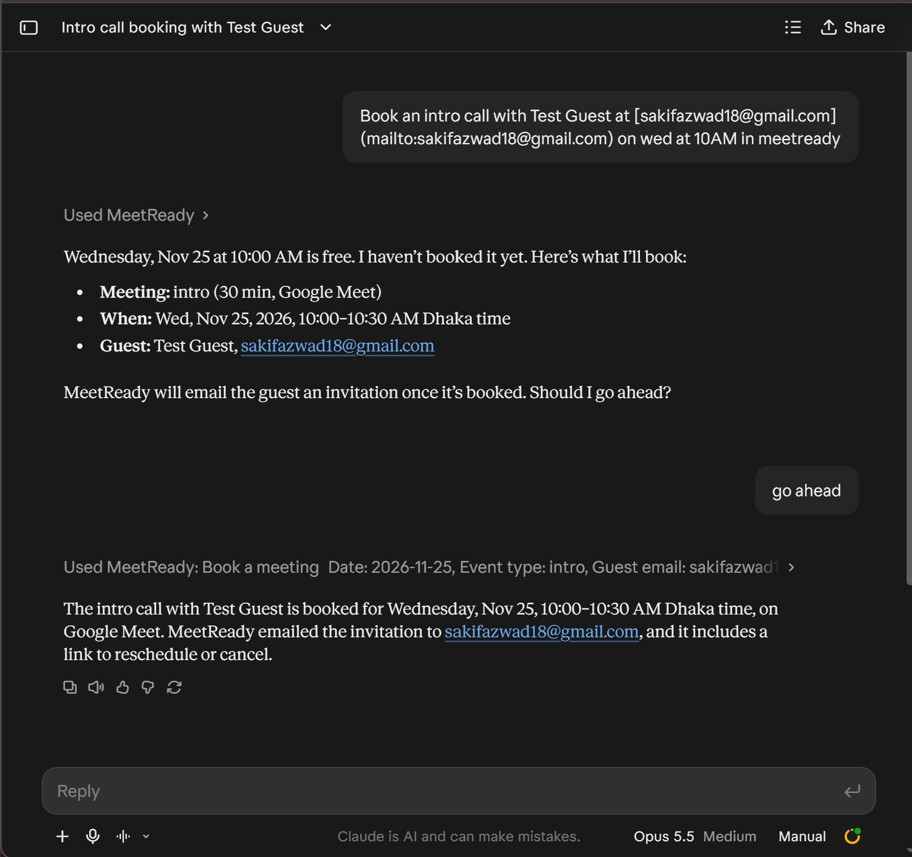

## Architecture

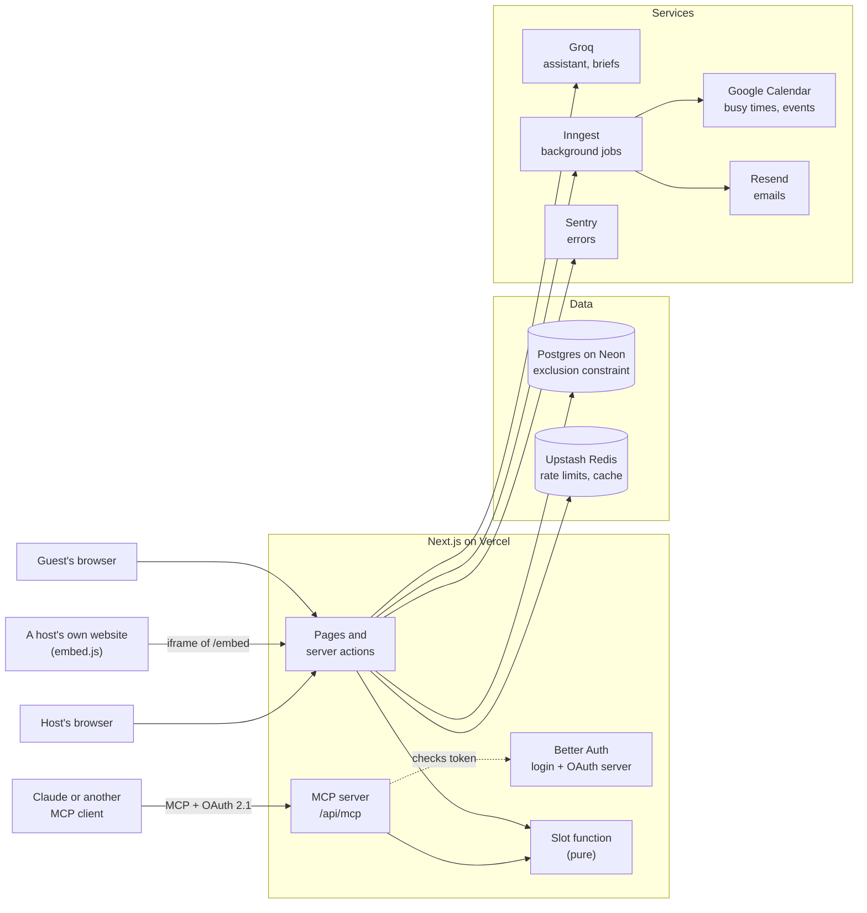

The slot function is the centre. It takes working hours, bookings and Google busy times and returns free times,
with no database or clock inside it. Every surface asks it, so the booking page, the AI assistant and Claude can
never disagree about when the host is free. Writing to Google Calendar and sending emails run as background jobs with
retries, so a booking is saved first and a slow service can't lose it.

## AI features

| Feature                                       | What the model does                                                                                                                    | What code does                                                                                                                       | Docs                                                                         |
| --------------------------------------------- | -------------------------------------------------------------------------------------------------------------------------------------- | ------------------------------------------------------------------------------------------------------------------------------------ | ---------------------------------------------------------------------------- |
| **Meeting brief** for the host                | Writes a summary, an agenda and what to prepare                                                                                        | Structured output checked with Zod, guest text treated as data, a cost log for every call                                            | [Day 18](docs/day-18.md)                                                     |
| **Booking assistant** for guests              | Turns "Wednesday morning, I'm in London" into a search                                                                                 | Checks the search, runs the slot function, returns up to three real times. Suggests only, never books                                | [Day 19](docs/day-19.md), [Day 20](docs/day-20.md)                           |
| **MCP server** for Claude, ChatGPT and others | Calls `list_event_types`, `find_free_times`, `list_bookings`, `get_booking`, `book_meeting`, `reschedule_booking` and `cancel_booking` | OAuth scopes for reading and changing, the booking page's own rules, a confirm form per change, safe retries, cleaned text to guests | [Day 21](docs/day-21.md), [Day 22](docs/day-22.md), [Day 24](docs/day-24.md) |

Models run on Groq through the Vercel AI SDK. Unit tests use a scripted fake model and the browser tests use a fake
Groq server, so CI never calls a real model. `npm run eval` checks the prompts against the real one.

## Stack

Next.js 16 (App Router, Cache Components) · TypeScript (strict) · PostgreSQL on Neon · Drizzle ORM · Better Auth
(Google login and OAuth 2.1 server) · Zod · shadcn/ui-style components (Radix) · React Hook Form · date-fns +
`@date-fns/tz` · Vercel AI SDK + Groq · MCP TypeScript SDK · Inngest · Upstash Redis · Google Calendar API ·
Resend · Sentry · Vitest + fast-check · PGlite (Postgres in-process for tests) · Playwright · GitHub Actions

## Getting started

```bash
npm install
cp .env.example .env.local   # Next.js
cp .env.example .env         # drizzle-kit
# fill in DATABASE_URL, BETTER_AUTH_SECRET and the Google OAuth client (see .env.example)

npm run db:migrate           # applies drizzle/*.sql (incl. the no-overlap constraint)
npm run dev
```

Everything else (Groq, Upstash, Inngest, Resend, Sentry) is optional in development. Without a key, that feature is
off or falls back: emails are saved as HTML files in your temp folder, background jobs run inline, and the AI
features are turned off.

## Scripts

| Script                                        | What it does                                                         |
| --------------------------------------------- | -------------------------------------------------------------------- |
| `npm test`                                    | Unit, property-based and database tests (no external DB needed)      |
| `npm run test:e2e`                            | Browser tests: production build + real Postgres (see below)          |
| `npm run typecheck` / `lint` / `format:check` | Same checks CI runs                                                  |
| `npm run db:generate`                         | New migration from `src/db/schema.ts`                                |
| `npm run db:studio`                           | Browse the database                                                  |
| `npm run eval`                                | AI evals against the real model (needs `GROQ_API_KEY`)               |
| `npm run shots`                               | Retakes the README screenshots and GIF from demo data (needs ffmpeg) |

## End-to-end tests

Playwright drives Chromium through the real flows against `next build` + `next start` on port 3100 and a throwaway
database. The flows include booking, the two-guest race, rescheduling and cancelling from the email link, booking
questions, phone layouts, the assistant, and connecting an MCP client and booking through it. Google and Groq are
replaced by small fake servers.

```bash
docker run -d -p 5432:5432 -e POSTGRES_PASSWORD=postgres postgres:17   # or any local Postgres
npx playwright install chromium                                        # once
npm run test:e2e                                                       # wipes and migrates meetready_e2e, builds, runs
```

`E2E_SKIP_BUILD=1` reuses the last build; `E2E_BROWSER_CHANNEL=chrome` uses your installed Chrome;
`E2E_DATABASE_URL` points elsewhere (its database name must contain `e2e`). Failures keep a trace:
`npx playwright show-trace test-results/<test>/trace.zip`.

## Design notes

Each day of the build has its own write-up with the decisions, the reasons and the bugs found along the way.

- [Day 1: setup, schema, slot generation](docs/day-01.md): timezone model, DST handling, the exclusion
  constraint, and why slot generation is a pure function.
- [Day 2: Google login, onboarding, authorization](docs/day-02.md): sessions, the three authorization
  layers, username rules, open-redirect protection.
- [Day 3: Event types and availability](docs/day-03.md): owner-scoped CRUD (IDOR tests), transactional
  schedule saves, forms with shared Zod schemas, and the bugs a real-browser run found.
- [Day 4: The public booking page](docs/day-04.md): three layers against double booking (re-check, per-host
  advisory lock, exclusion constraint), proven with deterministic race tests on real Postgres.
- [Day 5: Emails, invites, cancel and reschedule](docs/day-05.md): hashed guest manage tokens, `.ics` invites
  (UID/SEQUENCE/METHOD), emails sent with `after()`, a migration that's safe on existing data.
- [Day 6: Design, "Daylight"](docs/day-06.md): a design system where colour means time of day, the daylight
  band (same code as slot generation), two timezones on one timeline, landing page and dashboard.
- [Day 7: Brand, landing page and motion](docs/day-07.md): a logo built from the band, icons and link
  previews, a full landing page, account menu, 404/error pages, and view transitions that explain each change.
- [Day 8: UX upgrades from review](docs/day-08.md): timezone search from tz database data, the booking form
  in place, "in your daytime", week paging with booked/free hours, and "share times by text".
- [Day 9: Real daylight and scrubbing](docs/day-09.md): NOAA sunrise/sunset on every band (polar cases
  tested), hover/drag/keyboard time comparison, night times folded away, focus and 12h/24h fixes.
- [Day 10: Custom booking questions](docs/day-10.md): questions as jsonb on the event type, answers stored as a
  snapshot, one Zod schema built from the questions on both sides, and an ETag-style version for questions that
  change mid-booking.
- [Day 11: Browser tests in CI](docs/day-11.md): Playwright against the production build and real Postgres, a
  fresh host per test so everything runs in parallel, signed-in sessions without Google, and the bugs it found.
- [Day 12: Ready to deploy](docs/day-12.md): migrations on deploy (direct connection, advisory lock), real 404s
  from Proxy, security headers, the app URL from Vercel, smoke tests on the live site, and a Zod 4 trap.
- [Day 13: Error monitoring](docs/day-13.md): Sentry on server and browser, a privacy scrubber proven against
  real reports (tokens, emails, query values), Sentry v11's collect-everything defaults turned off, and the app's
  real address in the UI.
- [Day 14: Rate limiting](docs/day-14.md): Upstash Redis with a sliding window, limits keyed by what's abused
  (IP, guest inbox, manage token), fail open with reporting, hashed keys, IPv6 per /64, and one IP per E2E visitor.
- [Day 15: Google Calendar, busy times](docs/day-15.md): incremental OAuth on the Google login, free/busy only (no
  event details), busy times into the same pure slot function, fail closed at booking and cached for showing, and a
  fake Google for E2E. Follow-up: privacy policy and terms, so the Google app can be published.
- [Day 16: Google Calendar, writing](docs/day-16.md): each booking becomes an event with a Meet link, one
  idempotent "make Google match" sync for book/move/cancel/Retry, no duplicate invites, and reschedules that
  aren't blocked by their own event.
- [Day 17: Background jobs and reminders](docs/day-17.md): Inngest with one step per side effect, idempotency keys,
  automatic retries for Google writes and emails, reminders from a database sweep instead of long sleeps, the
  manage link stored hashed and encrypted, a backfill when a calendar is connected, and an inline fallback.
- [Day 18: AI meeting brief](docs/day-18.md): a summary and agenda for the host from the guest's answers, on Groq's
  free plan through the AI SDK, with structured output, five layers against prompt injection, a cost log per call,
  a fake model for unit tests, and evals against the real model.
- [Day 19: Booking assistant, server side](docs/day-19.md): a guest's sentence becomes a search the model writes
  and code checks, run through our own slot function; up to three real times come from the tool, never the model's
  text. Suggest-only, stateless, its own limits, a scripted fake model, and evals.
- [Day 20: Booking assistant on the page](docs/day-20.md): "Tell us when suits you" above the times; a suggestion
  selects that time in the grid (its day, its month, the guest's named city), a fresh read catches a time taken
  since, and the guest still confirms through the form. A fake Groq server makes the whole path testable in E2E.
- [Day 21: MCP server for AI assistants](docs/day-21.md): MeetReady as its own OAuth 2.1 server (Better Auth, Client
  ID Metadata Documents, PKCE, audience-bound JWTs, rotating refresh tokens), a consent page, four read tools for
  Claude or ChatGPT over the booking page's own slot function, and a Disconnect that works at once.
- [Day 22: Booking through an assistant](docs/day-22.md): `book_meeting` over MCP with the same rules as the booking
  page, a confirm form the model can't fill in (MCP elicitation, where the client supports it), emails that tell the
  guest who scheduled it, safe retries, and a test of the real SDK on both protocol versions.
- [Day 23: README and screenshots](docs/day-23.md): screenshots and the GIF taken by a Playwright script from seeded
  demo data, so they can be retaken after any UI change.
- [Day 24: Cancel and reschedule over MCP](docs/day-24.md): two destructive, idempotent tools for any of the host's
  upcoming bookings, one move core shared with the guest's reschedule, a free-time search that ignores the booking
  being moved, cleaned cancel reasons, and emails and labels that say the host did it, through which assistant.
- [Day 25: Insights, no-shows and the Move button](docs/day-25.md): rates, meetings per week, popular times and
  meetings per type, grouped in the host's timezone by Postgres; no-shows as a column with a check constraint;
  hand-built charts with validated colours, tooltips and table views; a Move button that reuses the booking widget
  in a host mode, with the slots API freeing a booking's own time only for its host.
- [Day 26: Signed webhooks and a theme switcher](docs/day-26.md): booking events POSTed in the Standard Webhooks format (HMAC
  signatures, timestamps, ids), retries through Inngest, SSRF protection when saved and at connect time (DNS
  rebinding), secrets encrypted with a 24-hour rotation overlap. For receivers: [docs/webhooks.md](docs/webhooks.md).
  Then System / Light / Dark, applied before the first paint with no flash, on static pages too.
- [Day 27: A booking widget for other websites](docs/day-27.md): one script, inline or popup, an iframe of
  `/embed/{username}/{slug}` (the only route other sites may frame), `postMessage` checked by origin and by source,
  a frame that fits its content as it changes, Escape passed out of the frame, and a see-through background that
  needed the right `color-scheme` on both sides. For site owners: [docs/embed.md](docs/embed.md). This completes
  Phase 2.
- [Day 28: Teams, roles and invite links](docs/day-28.md): team scheduling, part 1. Teams with an owner and
  members (one owner enforced by a partial unique index), role checks inside each write's own `WHERE`, hashed
  single-use invite links that a link preview can't use up, and two join races fixed two different ways (a
  conditional update for one link, a row lock for the team's size).
- [Deploying](docs/deploy.md): the runbook for Vercel + Neon (branch per preview), Google, Resend and GitHub.
- [Backlog](docs/backlog.md): everything not built yet, with the reason and when it fits.
- [Handoff](docs/handoff.md): one-page summary of the state, conventions and gotchas, for picking the work up fresh.

## Credits

MeetReady v1 (Jan–Feb 2024) was built by a team of 4:
[SakifAzwad/Meet-Ready](https://github.com/SakifAzwad/Meet-Ready). v2 is a solo rebuild that keeps the idea and
rewrites the code.
